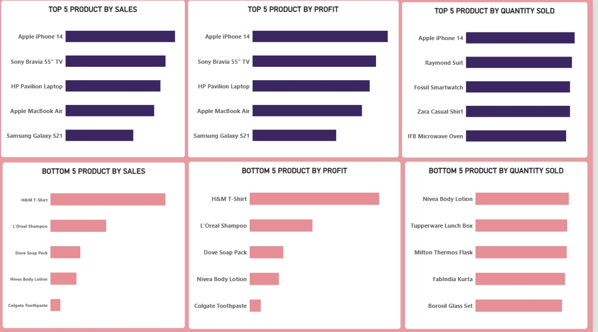
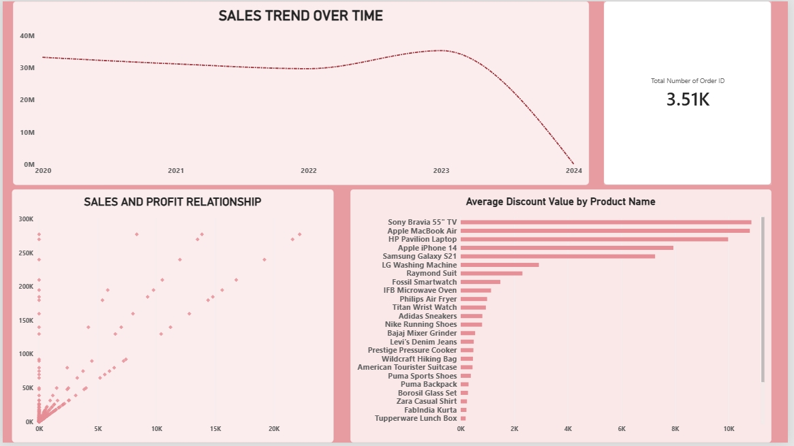
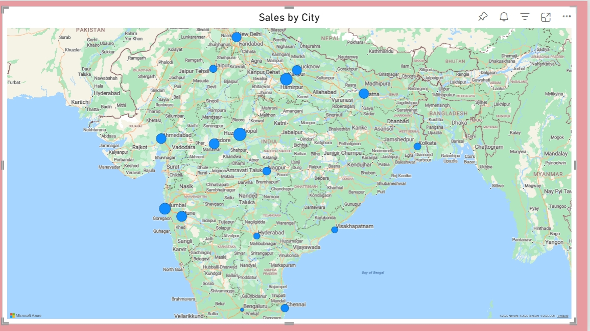
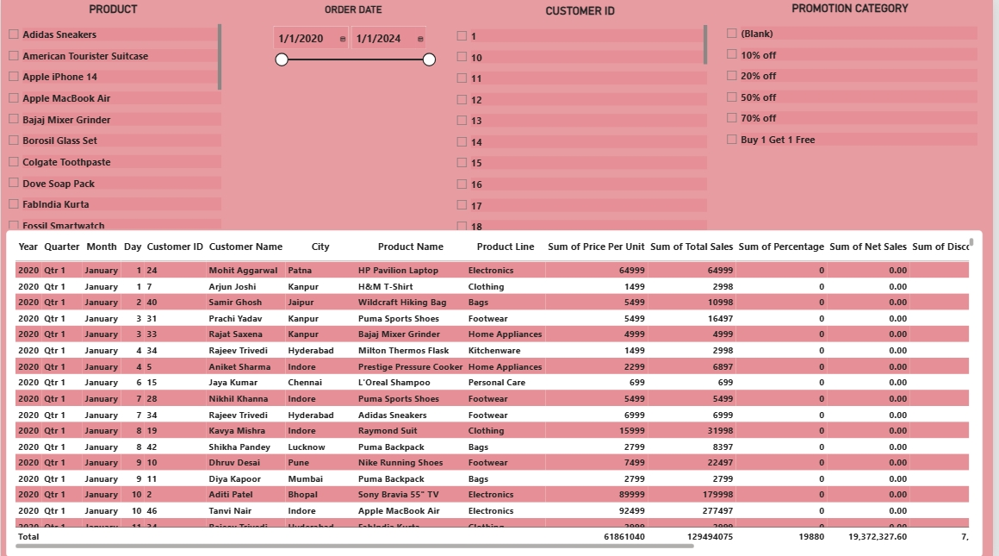
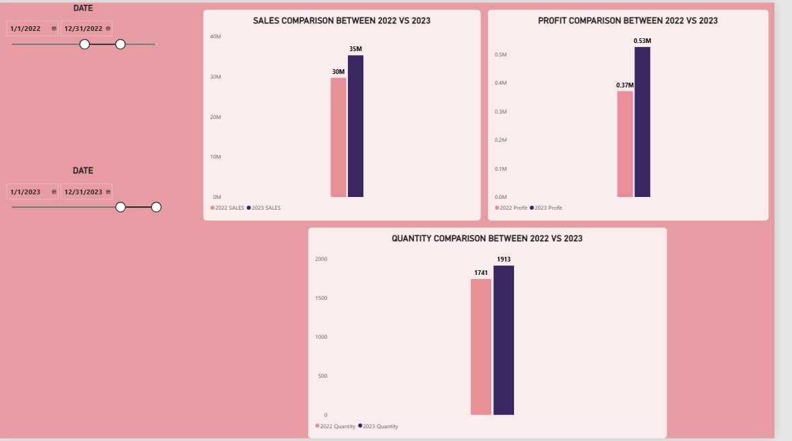

# Store_Sales_Performance_Analysis

## Project Overview
This project focuses on analyzing store sales performance using Power BI.
The goal of this project is to transform raw data set insights that can help stakeholders understand product performance, sales trends, compare business results across selected periods, and examine detailed order information.

---
## Business Questions Answered
- Question 1. Top and Bottom product peformance by sales, profit and quantity sold.
- Question 2. How do sales trend vary over time (daily, quarterly, and annually)
- Question 3. Show the relationship between sales and profit.
- Question 4. Show total sales broken down by different cities.

  ---
  ## Key Analysis
  - Sales Trends Over Time
  - Top 5 Products
  - Bottom 5 Products
  - Period Comparison
  - Order Analysis
  - Sales and Profit Analysis
  - Total Order

  ---
   ## Tools Used
  -
  - Power Query
  - DAX( Data Analysis Expression
  - Power BI Slicers
  - Power BI filters
  - Data Visualization
    
  ---
  ## Dashboard Preview
  -
  -
  -
  -
  -

  ---

  ## Key Findings
  - Sales performance showed an increase in the year 2023 and a decrease in the year 2024.
  - Comparing year 2022 and 2023 showed that 2023 had an increase in profit, sales and quantity more than 2022.
  - The analysis identified Apple iphone 14 as a leading contributor to sales, profit and quantity sold. 

  ---
  ## Files In The Repository
  - [Top and Bottom product analysis](TOP_BOTTOM_5_PRODUCT_ANALYSIS.jpeg)
  - [Sales performance Overview](SALES_PERFORMANCE_OVERVIEW.jpeg)
  - [Geographic sales analysis](GEOGRAPHIC_SALES_ANALYSIS.jpeg)
  - [Detailed order analysis](DETAILED_ORDER_ANALYSIS.jpeg)
  - [Period comparison analysis](PERIOD_COMPARISON_ANALYSIS.jpeg)
  - [Sales performance Dashboard](SALES_PERFORMANCE_DASHBOARD.pbix)
  - README.md

   ## Conclusion
  This project demonstrates how Power BI can be used to transform data into interactive business dashboard.
  It also highlights the importance of presenting data in a clear and interactive format to support informed business decisions.
